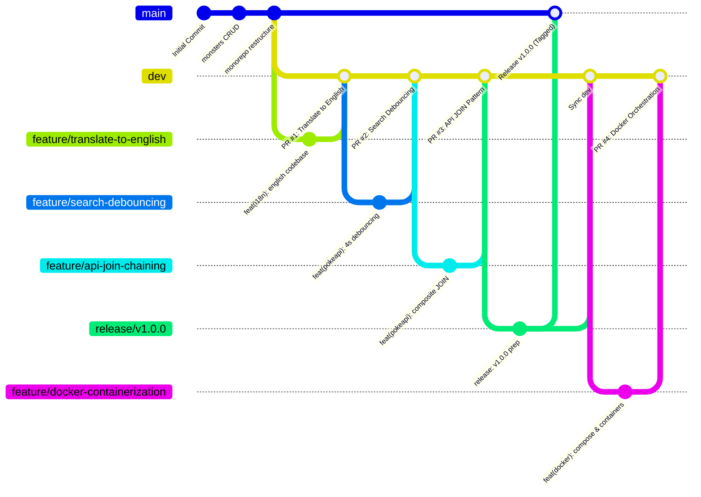

# Programación Web - Tarea 1 (Unified Monorepo & Gitflow)

[](file:///c:/Users/fslincango/Desktop/Séptimo/Programación%20Web/Tarea%201/README.md)
[](file:///c:/Users/fslincango/Desktop/Séptimo/Programación%20Web/Tarea%201/README.md)

Enterprise-grade monorepo consolidating both parts of **Web Programming Homework 1**, strictly adhering to the **Gitflow Branching Workflow**:

1. **Part 1 (`monsters/`)**: Fullstack Resident Evil B.O.W. Database (Java Spring Boot Backend with JPA/Hibernate + Pure Vanilla Web Frontend).
2. **Part 2 (`pokeapi/`)**: Interactive Pokédex OS consuming and coordinating 3 official PokeAPI REST endpoints via a composite relational JOIN pattern, responsive CSS Grid, live cry audio, and a 4-second Debouncing Engine.

---

## 🌿 Gitflow Workflow Architecture

The repository manages features, integrations, and releases using standard Gitflow:



### Pull Request (PR) Registry:

| PR ID | Branch Name | Target | Summary of Changes | Impacted Files |
| :--- | :--- | :--- | :--- | :--- |
| **PR #1** | `feature/translate-to-english` | `dev` | Full translation of backend Java methods, frontend JS logic, UI labels and comments to English. | `MonsterController.java`, `MonsterService.java`, `monsters index.html & script.js`, `pokeapi index.html & script.js` |
| **PR #2** | `feature/search-debouncing` | `dev` | Implementation of 4000ms (4.0s) delay debouncing engine on search input with live visual countdown badge. | `pokeapi/index.html`, `pokeapi/resources/css/styles.css`, `pokeapi/resources/js/script.js` |
| **PR #3** | `feature/api-join-chaining` | `dev` | Explicit documentation and DevTools console logging of the composite REST API JOIN pattern. | `pokeapi/README.md`, `pokeapi/resources/js/script.js` |
| **PR #4** | `feature/docker-containerization` | `dev` | Multi-container Docker orchestration (Spring Boot, PostgreSQL, and Nginx) via Docker Compose. | `.dockerignore`, `docker-compose.yml`, `monsters/Dockerfile`, `pokeapi/Dockerfile`, `README.md` |

---

## 📁 Repository Directory Structure

```text
Tarea 1/
├── .dockerignore                          # Build context exclusion rules
├── docker-compose.yml                    # Multi-container orchestration (App, DB, Web)
├── monsters/                             # PART 1: Spring Boot Backend + Frontend
│   ├── Dockerfile                        # Multi-stage JDK 27 build & JRE runtime image
│   ├── src/
│   │   ├── main/
│   │   │   ├── java/com/re/monsters/    # Controllers, Services, Models, Repositories
│   │   │   └── resources/
│   │   │       ├── application.properties.example
│   │   │       ├── init.sql             # Auto-seeded database schema and records
│   │   │       └── static/              # Frontend web assets
│   │   │           ├── index.html
│   │   │           ├── css/styles.css   # Modular CSS resources
│   │   │           └── js/script.js     # Vanilla JS CRUD integration
│   │   └── test/
│   ├── pom.xml
│   └── mvnw / mvnw.cmd
│
├── pokeapi/                              # PART 2: Vanilla Pokédex Application
│   ├── Dockerfile                        # Lightweight Nginx Alpine web server image
│   ├── index.html                        # Main Pokédex user interface
│   ├── resources/                        # Standardized static resources
│   │   ├── css/
│   │   │   └── styles.css                # Dark holographic cyber-theme & CSS Grid
│   │   └── js/
│   │       └── script.js                 # 3-Endpoint API engine, 4s debounce & JOIN logic
│   └── README.md                         # Detailed PokeAPI technical manual
│
├── .gitignore                            # Exclusions for IDEs, build artifacts & binaries
└── README.md                             # Global Monorepo & Gitflow documentation
```

---

## 🚀 Running the Projects

### 🐳 Option A: Multi-Container Docker Orchestration (Recommended)
You can build and start all microservices (Spring Boot app, PostgreSQL database, and Nginx Pokédex) simultaneously with a single command:

```bash
docker compose up --build
```

- **Part 1 (Monsters CRUD + DB)**: [http://localhost:8080](http://localhost:8080)
- **Part 2 (Pokédex OS)**: [http://localhost:80](http://localhost:80)
- **Database (PostgreSQL)**: `localhost:5432` (Auto-initialized with `init.sql`)

To stop all containers:
```bash
docker compose down
```

---

### 💻 Option B: Manual Local Development

#### Part 1: Monsters (Spring Boot + Static Web)
1. Open a terminal in `monsters/`.
2. Configure your database using `src/main/resources/init.sql` and `application.properties`.
3. Run the development server:
   ```bash
   ./mvnw spring-boot:run
   ```
4. Access the web interface at `http://localhost:8080`.

#### Part 2: PokeAPI (Interactive Pokédex)
1. Open a terminal or file explorer in `pokeapi/`.
2. Open `index.html` directly in any modern browser (Chrome, Edge, Firefox, Brave).
3. Open the Developer Tools console (`F12`) to inspect the real-time composite REST API JOIN logs.
