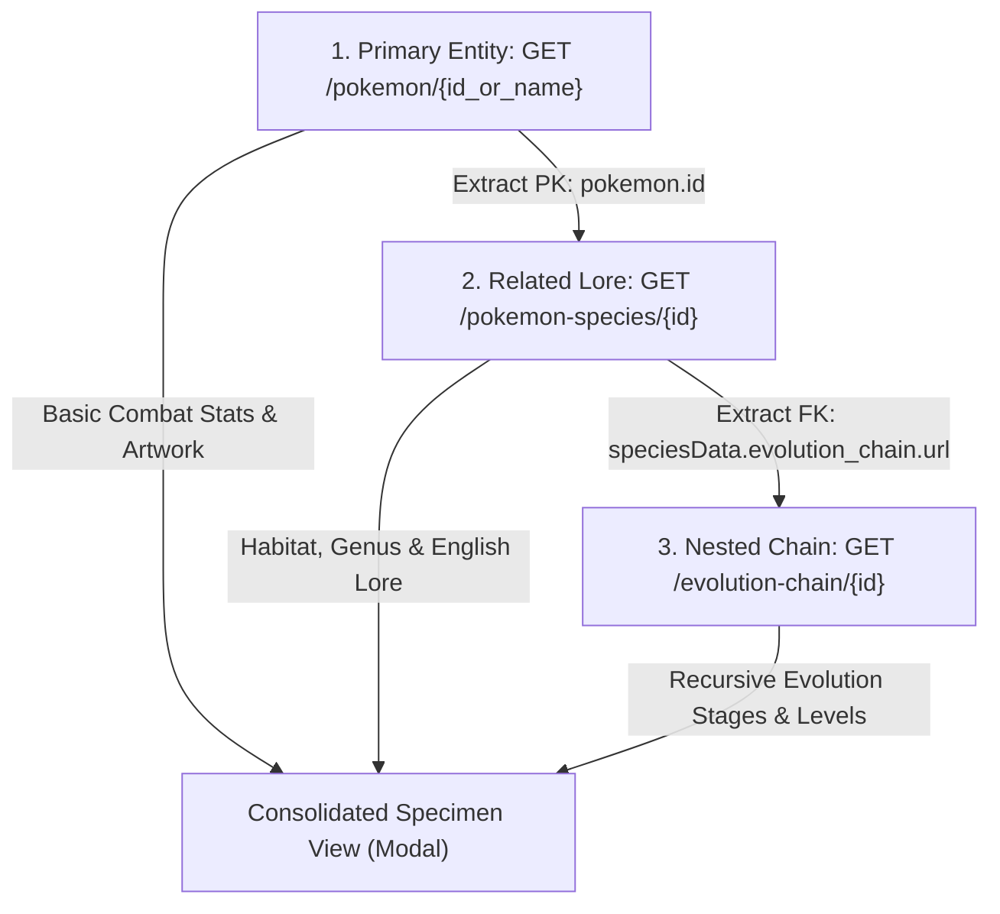

# Pokédex Archives // PokeAPI Database (Homework 1 - Part 2)

High-performance interactive Web Application developed in **pure HTML5, Vanilla CSS3, and Vanilla JavaScript**, consuming and combining data from **3 official REST endpoints from PokeAPI** using a **composite relational JOIN pattern**. Features responsive design powered by CSS Grid and Media Queries, high-definition official artwork, live cry audio playback, and an interactive biological modal.

---

## 🔗 The Composite REST API JOIN Pattern

In relational databases (SQL), a `JOIN` merges records from multiple tables based on related keys. In modern decoupled architectures, client-side or gateway API orchestration achieves the exact same composite result by querying related REST endpoints in sequence or parallel:



### Relational Mapping Breakdown:

1. **Step 1 (Base Entity - Table 1)**: `GET https://pokeapi.co/api/v2/pokemon/{id}`
   - **Fields**: `id` (Primary Key), `name`, `sprites`, `types`, `stats`, `height`, `weight`, `cries`.
2. **Step 2 (Joined Entity - Table 2)**: `GET https://pokeapi.co/api/v2/pokemon-species/{id}`
   - **Join Condition**: `pokemon-species.id = pokemon.id`.
   - **Fields**: `genera`, `flavor_text_entries`, `habitat`, `capture_rate`, `evolution_chain.url` (Foreign Key).
3. **Step 3 (Nested Joined Entity - Table 3)**: `GET https://pokeapi.co/api/v2/evolution-chain/{evolution_id}`
   - **Join Condition**: `evolution-chain.url = species.evolution_chain.url`.
   - **Fields**: Recursive `chain` object with `species`, `evolution_details.min_level`, `trigger`.

> **DevTools Inspection**: When opening any Pokémon modal in the application, check your browser's Developer Console (`F12` $\rightarrow$ Console) to view the collapsed `[REST API JOIN]` group logging each join step with payload metadata.

---

## ⏱️ 4-Second Debouncing Engine

To optimize network traffic and prevent excessive calls to external APIs while the user is typing, a **4000 ms (4.0s) Debouncing Engine** is built into the search bar:

- **Debounce Interval**: 4000 milliseconds of user inactivity required before dispatching the search and remote API request.
- **Visual Feedback**: A live countdown badge appears under the search input (`Debouncing request: 3.8s...`) so the user clearly sees the countdown in real time.
- **Immediate Bypass**: Pressing the `Enter` key or clicking the magnifying glass immediately flushes the debounce timer and performs the search instantaneously.
- **Instant Reset**: Clearing the search immediately aborts any active debounce timer.

---

## 📱 Responsive Grid System (Media Queries)

Card layouts adapt across screen dimensions using CSS Grid:

| Device Category | Breakpoint Media Query | Cards per Row |
| :--- | :--- | :--- |
| **Mobile Phones** | Default (`< 640px`) | **1 Card** per row |
| **Tablets / Medium Screens** | `@media (min-width: 640px)` | **2 Cards** per row |
| **Laptops / 1080p Desktop** | `@media (min-width: 1024px)` | **3 Cards** per row |
| **Ultrawide / 2K / 4K Monitors** | `@media (min-width: 1440px)` | **4 Cards** per row |

---

## 📁 Resource Architecture

According to standard frontend engineering practices, web assets are structured in dedicated resource folders:

```text
pokeapi/
├── index.html                  # Main entrypoint
├── resources/                  # Resource assets directory
│   ├── css/
│   │   └── styles.css          # Cyber-Pokédex dark theme & responsive grid
│   └── js/
│       └── script.js           # PokeAPI engine, 4s debounce & API JOIN logic
└── README.md                   # Technical documentation
```

---

## 🛠️ How to Run

1. Open `index.html` in any modern web browser (Chrome, Edge, Firefox, Brave).
2. Alternatively, use VS Code's **Live Server** extension for live reload.
